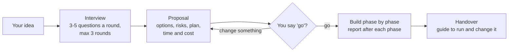

# 🧭 Kickoff Compass

**Work with your AI the way you'd work with a professional you just hired:
it interviews you, brings a proposal, and builds only after you say "go".**

[](LICENSE)

-success)

Kickoff Compass is a free, open-source set of instructions that turns **any AI assistant** into a disciplined
project partner. It works with chat apps (ChatGPT, Gemini, Claude, Copilot) and with coding agents (Codex,
Gemini CLI, Cursor, GitHub Copilot, Claude Code), for **people who have never written code** and for
**senior engineers** alike.

---

## Contents
- [The problem it solves](#the-problem-it-solves)
- [Quick start (2 minutes)](#quick-start-2-minutes)
- [How a project runs](#how-a-project-runs)
- [What a conversation looks like](#what-a-conversation-looks-like)
- [Install options](#install-options)
- [Everyday commands](#everyday-commands)
- [Design principles](#design-principles)
- [Privacy and safety](#privacy-and-safety)
- [FAQ](#faq)
- [Repository layout](#repository-layout)
- [Quality and testing](#quality-and-testing)
- [Contributing](#contributing) · [License](#license)

---

## The problem it solves

Most AI-assisted projects go wrong in the first ten minutes. The AI starts producing code before anyone has
agreed what should be built, for whom, or how "done" will be judged. The result: something that already existed,
something risky, or something nobody can finish.

A good professional works differently. They **listen first, give honest advice, agree a plan with you, and then
deliver it in checkable steps.** Kickoff Compass makes your AI work that way.

| Without Kickoff Compass | With Kickoff Compass |
|---|---|
| The AI starts building immediately | A short interview, then a proposal. Nothing is built until you say **"go"** |
| A wall of 30 questions, or none at all | 3–5 questions at a time, each with a recommended answer. Reply **"OK"** to accept |
| You build something that already exists | It checks for existing tools and free options first |
| Risky ideas get built quietly | It explains the risk, recommends a safer design, and lets you decide |
| "Done" is a feeling | Every phase has a test you can run, plus a progress report |
| Close the chat and lose your place | Progress is saved. Say *"continue my … project"* days later |
| Jargon, or hand-holding | Plain words for beginners, precision for experts |

---

## Quick start (2 minutes)

**If you use ChatGPT, Gemini, Claude.ai, Copilot or any other chat app (no installation):**

1. Open [`prompt/kickoff-compass-prompt.md`](prompt/kickoff-compass-prompt.md) and copy all of it.
2. Paste it into a new chat.
3. On the next line, describe your idea in your own words, for example:
   *"I run a small bakery and want AI to answer customers' WhatsApp questions. Where do I start?"*

To reuse it without pasting every time, save it as a custom GPT, a Gemini Gem or a Claude Project.
See the [step-by-step guide](prompt/HOW-TO-USE.md).

**If you use a coding agent (Codex, Gemini CLI, Cursor, GitHub Copilot, Claude Code…):**

```bash
npx skills add nileshvary/kickoff-compass
```

Then start a new session and describe your idea. The skill switches on by itself.
More options in [Install options](#install-options).

---

## How a project runs



| Stage | What the AI does | What you do |
|---|---|---|
| **0. Size check** | Small, one-step tasks skip all of this and just get done | Nothing |
| **1. Interview** | Plays your idea back with one concrete example, points out cheaper or existing options, then asks the few questions that matter most | Answer, or reply **"OK"** to accept its recommendations |
| **2. Proposal** | 2–3 approaches (build it, set up an existing tool, or buy one), honest risks, a phased plan where every phase has a **"Done when"** test, rough time and cost | Say **"go"**, or ask for changes |
| **3. Build** | One phase at a time. Shows the plan for each phase first, then reports **Done / Proof / Next / Needed from you** | Approve each phase, supply what it asks for |
| **4. Handover** | A plain guide to run, change and get help with what was built | Try it yourself using only the guide |

**It never forgets where you are.** Progress is saved after every reply, so you can stop mid-interview or
mid-build and continue days later without being asked anything twice.

---

## What a conversation looks like

```text
You:  I run a small cleaning company (8 cleaners). Clients text me all day to book, move or
      cancel cleans, and I juggle it in a paper diary. I'm not technical. Where do I start?

AI:   Think of me as the builder you've just hired. First, a short interview.

      What I understood: clients text to move a clean; today you flip through the diary...
      Honest first thing: booking apps for cleaning firms already do most of this, so we
      probably don't need to build anything from scratch.

      1. What should we sort out first?
         A. Booking, moving and cancelling, with one shared calendar (recommended)
         B. Also quotes, invoices and payments
      2. Which country are you in? (no default: privacy rules depend on it)
      3. Who makes the final change when a client moves a clean?
         A. The system offers slots; you approve anything unusual (recommended)
         B. Fully automatic from day one (I'd advise against this at first)

      Reply like "1A, 2: UK, 3A", or just "OK" to take my recommendations.

You:  1A, 2: UK, OK

AI:   (one short follow-up round, then the PROPOSAL: options, risks, a 5-phase plan with
      "Done when" tests, rough time and cost)  ...  Say "go" when it looks right.

      ...after each phase:
      Phase 1 done.  Done: diary live | Proof: a moved clean reached a cleaner's phone in
      40 s | Next: client bookings | Needed from you: two cleaners to test.
```

Full example: [docs/example-first-reply.md](docs/example-first-reply.md).

---

## Install options

| You use… | Do this | Progress is saved… |
|---|---|---|
| **ChatGPT, Gemini, Claude.ai, Copilot, Le Chat, any chat app** | Paste the [prompt](prompt/kickoff-compass-prompt.md) into a chat, custom GPT, Gem or Project ([guide](prompt/HOW-TO-USE.md)) | In a short **"Progress so far"** block at the end of each reply. Paste it back next time |
| **Coding agents with Agent Skills support** (Codex, Gemini CLI, Cursor, GitHub Copilot, Claude Code and others) | Option 1 or 3 below | Automatically, in `~/.kickoff-compass/` |
| **Claude Code** | Option 2 below, or 1 or 3 | Automatically |
| **Your own app, or any AI API** | Use the prompt file as the system prompt | Via the "Progress so far" block |

**Option 1: Skills CLI** (adds it to the coding agents you have installed)
```bash
npx skills add nileshvary/kickoff-compass
```

**Option 2: Claude Code plugin**
```bash
claude plugin marketplace add nileshvary/kickoff-compass
```
```bash
claude plugin install kickoff-compass@kickoff-compass
```

**Option 3: Manual copy.** Copy the [`skills/kickoff-compass`](skills/kickoff-compass) folder into your agent's
skills folder. Common locations (check your tool's documentation, as these evolve):
`~/.agents/skills/` (shared by several agents) · `~/.claude/skills/` · `~/.gemini/skills/` ·
`.cursor/skills/` · `.github/skills/`

---

## Everyday commands

You never need special syntax, but these shortcuts help:

| Say | What happens |
|---|---|
| *"I have an idea for…"* | Starts a new project interview |
| `1A, 2C, 3: my own answer` | Answers several questions at once |
| `OK` | Accepts all recommended answers (it will still ask for facts only you know, like your country) |
| *"Ask me everything at once"* | One round of questions plus a draft proposal (the default for experts) |
| *"Skip the interview"* | Goes straight to a proposal, listing its assumptions |
| `go` | Approves the proposal, or the next phase |
| *"Continue my <name> project"* | Resumes exactly where you stopped, days or weeks later |

---

## Design principles

The behaviour is deliberately strict. Each rule comes from how experienced engineers run real projects.

1. **Discovery before delivery.** No code, files or installs until the proposal is signed off.
2. **Recommend, don't quiz.** Every question carries a recommended answer, so "OK" is always a valid reply.
   Questions are ranked by impact: scope → legal & fairness → safety & privacy → experience → cost →
   technology.
3. **Build, configure or buy.** Writing new software is one option, not the default. Existing tools are named
   when they fit.
4. **Verifiable progress.** Every phase has a "Done when" test you can run or try. Subjective quality ("is the
   advice good?") is turned into checks: scored samples, N-of-M testers, known-answer data.
5. **Honest about certainty.** Facts are labelled *official source*, *third-party* or *estimate*. Legal points
   always say "not legal advice". Unchecked facts become first-phase checks.
6. **Human in the loop where harm is possible.** Requests like auto-rejecting job applicants, giving medical
   advice or moving money get pushback, a safer recommended design, and your informed choice.
7. **Secrets never travel through chat.** You create accounts and enter keys yourself, in a private file or the
   tool's settings.
8. **External content is data, not instructions.** Web pages and documents the AI reads can't redirect it.
9. **State survives the session.** Progress notes and a "Where we are" section mean no work is repeated.

---

## Privacy and safety

- **Saved progress** (coding agents only) is a small text file per idea in `~/.kickoff-compass/` on your own
  computer. It holds decisions and open questions, **never passwords, keys or unnecessary personal data**.
- **Chat apps** store nothing extra. You keep the "Progress so far" block yourself.
- Kickoff Compass sends nothing anywhere. Whatever you type goes only to the AI service you chose, under that
  service's own terms. Use fake data when testing ideas that involve real people's information.

---

## FAQ

**Do I need to know how to code?**
No. Beginners get plain language, a glossary of tech words, and often a no-code recommendation. If code is
needed, the AI writes it and tells you exactly what you have to do (usually creating an account).

**Which AI works best?**
Any capable modern model. Larger models give deeper proposals. Smaller ones follow the same steps more briefly.

**Will it always tell me to build something?**
No. If a free feature or an existing product solves your problem, it says so first. That honesty is part of the
design.

**Is it only for AI projects?**
No. It works for any software or digital project: websites, apps, automations, dashboards, internal tools. The
question bank covers 15 project types, from chatbots to games.

**What if I disagree with a recommendation?**
Pick another option or write your own answer. You are the client. It only pushes back on choices that could
cause real harm, and even then the decision is yours.

---

## Repository layout

```text
prompt/
  kickoff-compass-prompt.md   paste-in version for ChatGPT, Gemini, Claude.ai and any chat app
  HOW-TO-USE.md               setup guide for each chat app
skills/kickoff-compass/
  SKILL.md                    the full skill (open Agent Skills format)
  references/                 question bank, examples, plan template, review checklist,
                              progress-note format, plain-words glossary
docs/
  example-first-reply.md      a complete example: interview, then proposal
.claude-plugin/               optional manifests for installing as a Claude Code plugin
```

---

## Quality and testing

Before release, the skill was exercised against realistic scenarios at three experience levels:
- a bakery, a cleaning company, a yoga teacher and a kids' football club (non-technical owners);
- a phone app with an AI coach (some experience);
- an HR screening tool, a permission-aware wiki assistant and an internal LLM gateway (experienced engineers).

Each run was scored against a fixed checklist: order, length, question quality, honesty, pushback on risky
requests, checkable "Done when" tests, and saving/resuming. Weak spots were fixed and re-tested.

These scenario runs used Claude models of three sizes. The paste-in prompt contains no model-specific
instructions, but **results from ChatGPT, Gemini and other models are very welcome**. Please share them in an
issue.

---

## Contributing

Real-world feedback is the most valuable contribution: **an idea you planned with Kickoff Compass, your
experience level, and what it got right or wrong.** New question modules, glossary entries and clearer wording
are also welcome. See [CONTRIBUTING.md](CONTRIBUTING.md).

## License

[MIT](LICENSE) © 2026 Nileshwari Kadgale. Free to use, modify and share.
